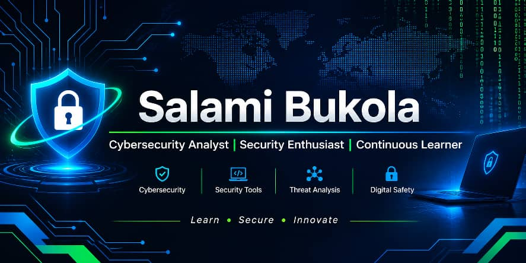

  

  

---

## 👋 Hi, I'm Salami Bukola

I'm an **Aspiring Cybersecurity Professional**, **Security Enthusiast** and **Continuous Learner**, passionate about cybersecurity, technology, Linux and digital transformation. I'm focused on building practical skills, documenting my progress and growing a professional presence in the security community.

---

## 🧑‍💻 About Me

- 🔐 Building my career in cybersecurity
- 🔎 Developing practical skills in threat and security analysis
- 🧪 Enjoying hands-on cybersecurity labs and security research
- 🌍 Interested in the intersection of cybersecurity, technology and digital transformation

---

## 🔵 Cybersecurity Skills

- Vulnerability Assessment
- Network Security
- Web Application Security
- Security Analysis
- Security Awareness
- Linux Security
- Reconnaissance
- Threat Analysis

---

## 🛠️ Tools & Technologies

  

  
  
  
  
  

---

## 📚 Currently Learning

- 🌐 Web Application Security
- 🛰️ Network Security
- 🔍 Vulnerability Assessment
- 🐍 Python for Cybersecurity
- 🐧 Linux

---

## 🧪 Hands-On Cybersecurity

I learn by doing. My practical work takes place in **controlled cybersecurity labs and environments**, including:

- Kali Linux
- Metasploitable 2
- Network reconnaissance
- Vulnerability discovery
- Web application security testing
- Exploitation in authorized lab environments
- Security analysis

> ⚠️ All activities are performed for **ethical, educational and authorized security testing purposes only**, within environments I own or have permission to test.

---

## 🚀 Featured Projects

| Project | Repository |
|---|---|
| 🛡️ Cybersecurity Labs | `Add repository link here` |
| 🐍 Python Security Projects | `Add repository link here` |
| 🌐 Web Security Projects | `Add repository link here` |
| 🔍 Vulnerability Research | `Add repository link here` |
| 📚 Cybersecurity Learning Resources | `Add repository link here` |

---

## 📊 GitHub Statistics

  
  

  

  

---

## 💡 My Philosophy

> Cybersecurity is about protecting people, data and trust. I practice it ethically, learn continuously, and believe technology is most powerful when it empowers others.

---

## 🤝 Let's Connect

  
  
  

---

  <b>Securing the digital world, one lab at a time.</b> 
  Thanks for visiting my profile. 🔐

